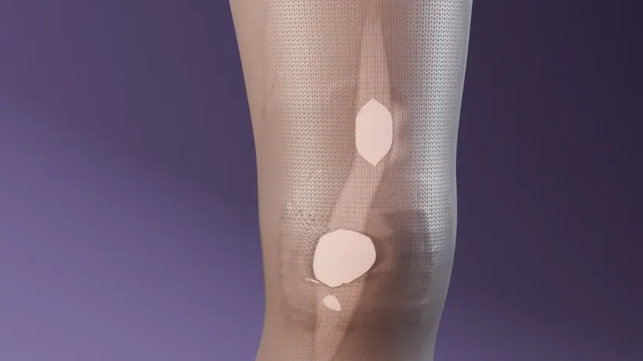

# Weft Lab

一个能在 Blender 3D 视口里直接“上手撕”的针织袜面交互插件。

按住鼠标轻拽，能看到织物从皮肤表面被拉起。继续往外拉，袜面会顺着针织纹路漏针、开孔。松手后孔缘会自然回弹，你还可以抓着旧孔旁边的料子接着撕，或者把两个孔之间剩下的布桥拉断。切到湿态模式后，还能往袜面上加水，观察水膜扩散、织物吸水以及重新贴合皮肤的过程。


短片前半段从第一次轻拉拍到两处缺口贯通。后半段在完整袜面上泼入 2 mL 水，跟着水膜看织层吸水，再看同一块湿布被抓起、松手回贴和再次拉破。画面取自真实 Blender 视口操作产生的网格和液体状态，使用 EEVEE 逐帧渲染。[下载 1080p 干湿演示](https://github.com/MrH0v0/weft-lab/releases/download/v0.4.40/weft-lab-leg-dry-wet-0.4.40.mp4) · [查看孔缘原图](docs/yarn-detail.jpg)



## 安装

当前版本 **0.4.40**，已在 **Windows x64 + Blender 5.3.0** 下验证通过。插件要求 Blender 5.3.0 及以上，其他系统暂未实测。

1. 在 **Releases → Assets** 下载插件包 `weft_replay-0.4.40.zip` 和已绑定的示例工程 `weft-lab-leg-studio-0.4.40.blend`。[前往下载](https://github.com/MrH0v0/weft-lab/releases/tag/v0.4.40)
2. 打开 Blender，进入 **编辑 → 偏好设置 → 获取扩展**，点右上角菜单选择 **从磁盘安装**，选中插件 ZIP 并启用。
3. 打开下载的 `.blend`，鼠标悬停在 3D 视口内按 `N` 展开侧栏，切到 **Weft Lab**。腿模、骨架、针织贴图和摄影棚都已放在同一个工程内。[试穿腿模说明](examples/leg/README.md)

## 上手试撕

**干态体验**

1. 选择 **干态抓取**，把鼠标移到小腿有织纹的区域，按住左键先轻轻往外拖，再继续拉远。
2. 看到开孔后松手，下一把可以把抓点放在孔尖旁还有织纹的位置接着撕。
3. 撕出两个相邻的孔后，去拽中间剩下的布料，可以看到布桥一点点变窄，直到彻底拉断贯通。

**湿态与材质调节**

1. 点 **结束实验并恢复原袜** 重置，然后切换到 **湿态抓取 / 泼水**。
2. 鼠标悬停在袜面上按 `W` 加水，再抓住湿润的部位拖动、松手。
3. 面板里可以切换黑色、烟灰、肤色、白色四种配色，并分别调节 **光学厚度** 和 **现场织纹尺寸**。

## 用在自己的角色上

如果想把这套效果套在自己的模型上，先确认**袜面和皮肤网格由同一套骨架驱动**，并且**按米建模**。

1. 在 **半自动袜面绑定** 中分别指定袜面和皮肤网格。
2. 点 **在袜面点选抓点**，选中脚踝附近的袜面后，点击 **生成回放副本**。
3. 点 **干态抓取** 可以固定姿势，仔细对比不同撕法下的孔形。点 **随骨架动作抓取** 可以一边播放角色动画，一边实时抓放。

袜长调整、动作贴肤准备以及探针的详细用法见[使用说明](extension/weft_replay/USER_GUIDE.md)。

## 保存与重开

| 保存时的状态 | 重开工程后可以做什么 |
| --- | --- |
| 有缺口的干袜 | 保留当前的孔缘形态，在原姿势下点 **接着撕当前缺口** 即可继续抓撕 |
| 湿袜 | 保留当时的孔形、湿膜和液量读数，恢复原袜后可开始下一次实验 |
| 固定缓存回放 | 直接拖动时间轴，逐帧查看已经烘焙好的动作 |

> 保存工程会停掉当前的实时求解，把这一刻的袜面状态“定格”下来。实时鼠标轨迹和水量演化不会自动烘焙成动画。

## 从源码构建

在仓库根目录用 **Python 3.11+** 运行以下命令即可打包并校验。

```console
python tools/build_extension.py
blender --command extension validate dist/weft_replay-0.4.40.zip
```

安装包会写入 `dist/`。Windows x64 原生几何模块的 C++ 源码和编译命令见[原生模块构建说明](tools/BUILD.md)。

## 许可与致谢

Weft Lab 贡献者编写的源码采用 **MIT**，包括针织与撕裂算法、原生几何内核和构建脚本。包含 Blender Python API 绑定的完整扩展同时按 **GPL-3.0-or-later** 提供。[MIT 许可](LICENSE) · [扩展 GPL 许可](extension/weft_replay/LICENSE.txt) · [Blender 许可说明](https://www.blender.org/support/faq/)

本版演示用的腿模、骨架、织物材质、摄影棚和干湿演示画面均由 Weft Lab 制作，采用 MIT 许可。插件内置脚踝固定回放的人体几何源自 MakeHuman hm08，撕裂声取自 Joseph Sardin 的录音，二者的原始素材均为 CC0。[第三方声明](extension/weft_replay/THIRD_PARTY_NOTICES.md)
