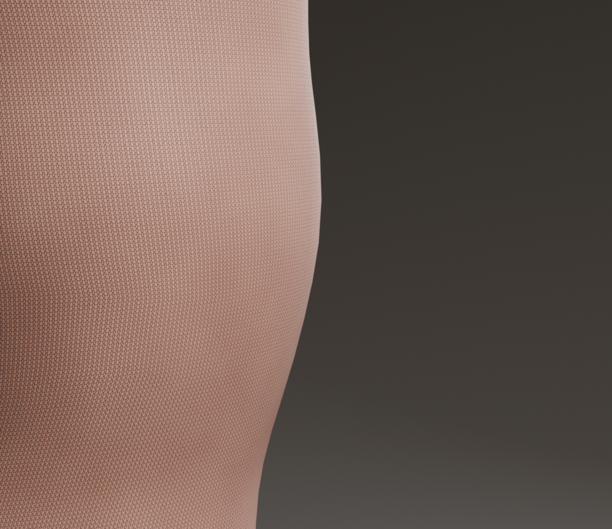
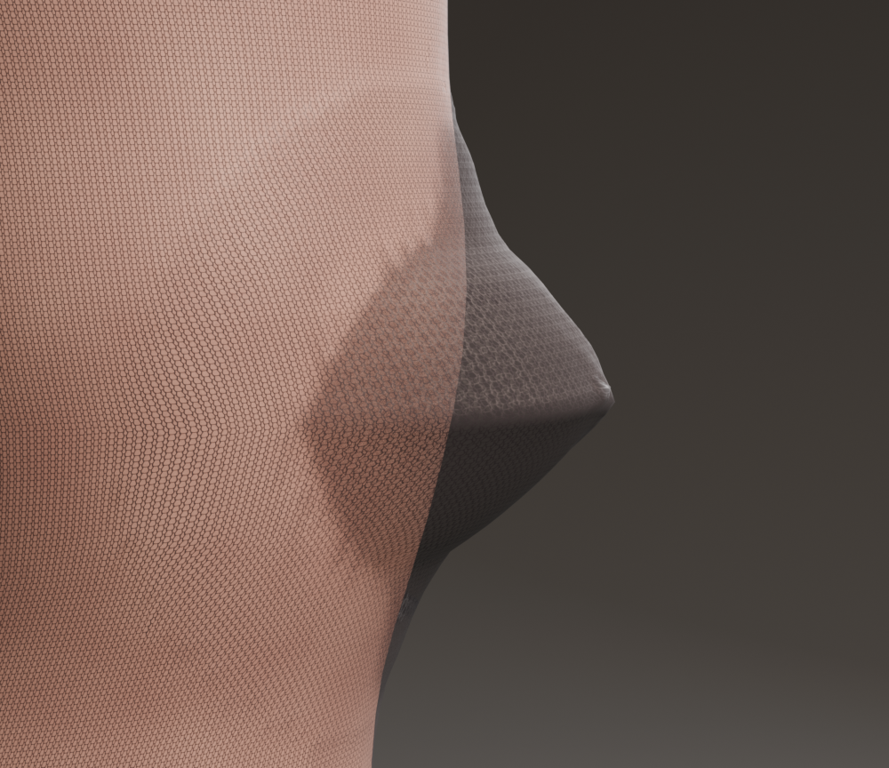
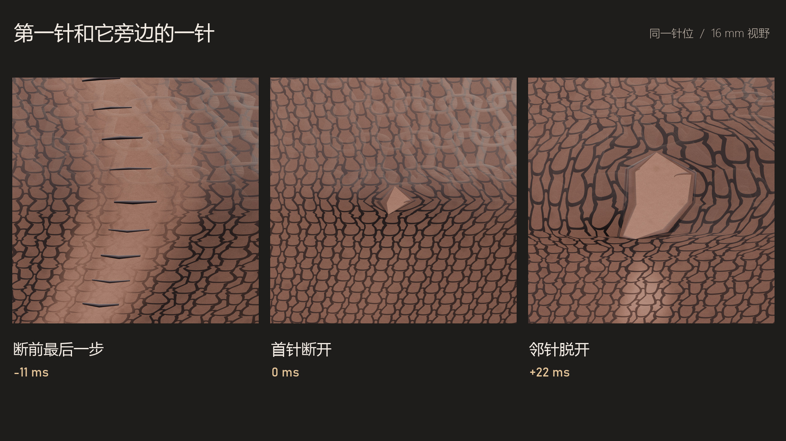
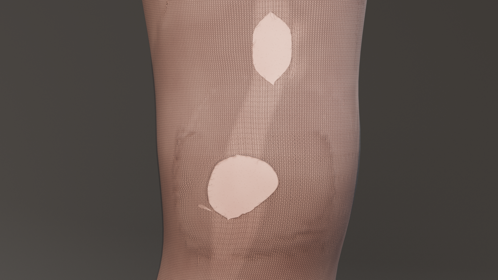
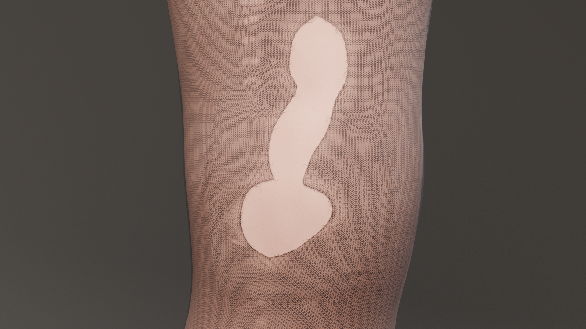
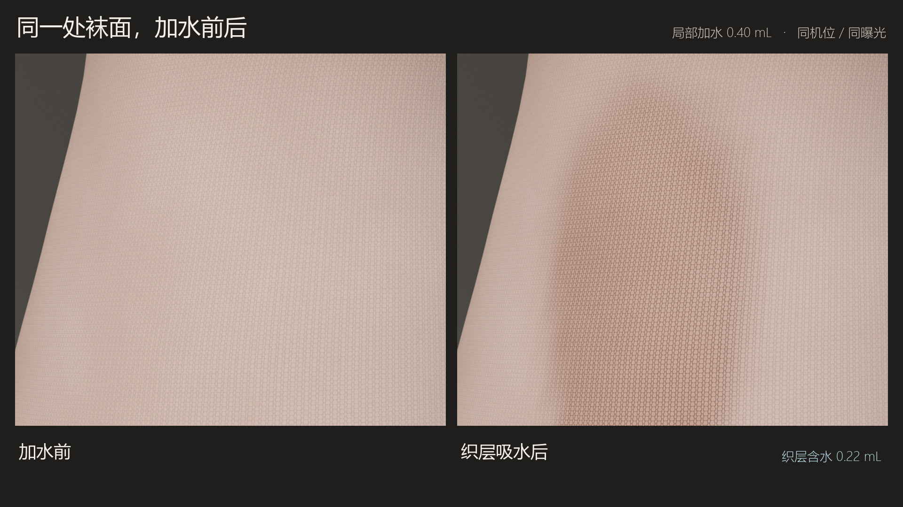

# 物理状态图解

同一块袜面可以贴着皮肤，也可以被提起。观察开孔时，先看抓点离皮肤有多远，再看两侧针圈之间还有没有织物相连。下面的图和读数来自 Weft Lab 0.4.40 原创腿模的开发记录。[打开对应的试穿工程说明](../examples/leg/README.md)

## 贴肤、提离与绷紧

| 刚抓住袜面 | 保持抓取，向外慢拉 |
| --- | --- |
|  |  |

看腿的侧面轮廓。左图抓点离肤约 **0.10 mm**。拉到右图时，间隙已达 **26.05 mm**，破口数仍为 **0**。这时松手，完整的织物会回弹并重新贴近皮肤。

## 首针断开与沿纹脱圈

以中图首针断开为 **0 ms**。往前 **11 ms**，针圈已拉长。再看右图，首断后 **22 ms**，旁边一针也脱开，孔口随之扩大。松手时孔缘会收窄，已经断开的针圈仍留着缺口。

## 旧孔续撕与布桥贯通

抓住旧孔尖端旁还有织纹的位置，继续拉可以扩大原孔。两个孔之间剩下的窄条织物叫**布桥**。布桥仍连着时，拉一边会带动邻孔开合。把抓点移到布桥上并沿侧向拉，直到中间也撕开。

| 撕布桥前 | 撕断并松手后 |
| --- | --- |
|  |  |

右图拍在松手回弹之后。两个旧孔已经连成一个缺口，这次记录里，原布桥两岸间距的中位数仍有 **18.5 mm**。

## 表面水膜、织层吸水与湿布回贴

水落在袜面后，一部分沿外表面流动，一部分浸入织层。外面的水膜变薄时，吸了水的纱线仍然显深。图中这次局部加水为 **0.40 mL**，拍右图时织层含水约 **0.22 mL**。

在同一次湿态实验里，轻提湿布时标记点离肤 **21.37 mm**，松手回贴后为 **0.08 mm**，此时袜面仍然完整。再次抓住湿处拉远，针圈同样可以断开。[观看湿布抓起、回贴和拉破的连续过程](../README.md#演示视频)

## 在 Blender 里查看同一处的读数

启动一次干态或湿态抓取，展开 **目标袜面 · 实时监测**，点 **监测当前袜面**。在视口用 **Shift + 左键** 选中仍有织纹的位置。按 **Space** 暂停，按 **→** 走一个物理步，再切换物理图，就能在同一时刻比较下面几项。

| 想确认什么 | 看哪里 |
| --- | --- |
| 针圈沿哪个方向被拉长 | **伸长率 · 纵向 / 横向**。正值表示相对参考姿势伸长，负值表示缩短。 |
| 布面有没有离开皮肤，哪里已经开孔 | **离肤／损伤**。最近皮肤间隙以 mm 表示，正值表示离开皮肤，紫色标出孔边。再看面板里的破口数和失效线圈数。 |
| 水留在袜外、织层还是皮肤上 | 依次切换 **浸润 · 袜外膜**、**浸润 · 织层** 和 **浸润 · 皮肤侧**。两侧水膜读厚度，织层读饱和度。 |

表中的伸长率以启用监测时的贴合姿势为参考。图中给出的距离、时间和液量只对应那次操作，抓点、拖动轨迹和材料参数都会影响结果。
